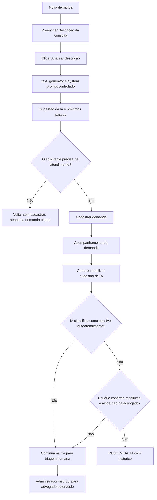

# BJN — Orientação inicial com IA, distribuição de teste e Central de Documentos

## 1. Objetivo e limites

Reduzir consultas jurídicas simples por meio de uma **sugestão informacional** gerada sobre a `Descrição da consulta`, sem substituir análise jurídica, sem acessar anexos e sem encaminhar ou encerrar demandas automaticamente. A IA não produz cláusulas ou minutas: o mecanismo de cláusulas permanece associado ao `script_bjn` e ao book original.

Toda recomendação é preliminar. Contratos concretos, LGPD, litígios, compromissos, riscos jurídicos ou dúvidas que dependam de decisão interna devem ser encaminhados a pessoa habilitada. A política de autoatendimento precisa da aprovação do Jurídico, Compliance e DPO antes de uso real.

## 2. Fluxo de telas



### Tela de nova demanda

- Digite no campo **Descrição da consulta** (15 a 8.000 caracteres) e clique em **Analisar descrição**.
- Somente esse campo é transmitido ao `text_generator`, por ação explícita. Nenhum documento, nome de envolvido, identificação ou outro campo é enviado no contexto desta análise.
- A interface mostra resumo, orientação, etapas sugeridas e encaminhamento recomendado.
- Em `POSSIVEL_AUTOATENDIMENTO`, há um link para voltar sem registrar demanda. O usuário pode optar por cadastrar normalmente mesmo assim.
- Em `ATENDIMENTO_HUMANO`, é exibida a recomendação de seguir com o cadastro. A sugestão não bloqueia o atendimento humano.
- Uma mudança no texto invalida visualmente a orientação anterior para evitar exibir resposta de uma versão desatualizada.

### Acompanhamento

- **Sugestão da IA** fica antes do histórico de andamento. O usuário autorizado solicita a análise mediante botão.
- Ao analisar demanda existente, o backend grava a sugestão, hash do prompt, hash da descrição e evento de auditoria, com acesso limitado pelos controles já existentes da demanda.
- O solicitante pode escolher **Esta orientação resolveu minha dúvida** somente quando não existe advogado distribuído, o status é `RECEBIDA`/`EM_TRIAGEM`, e a sugestão indica `POSSIVEL_AUTOATENDIMENTO`.
- Uma confirmação adicional muda o status para `RESOLVIDA_IA`. Isso registra **a percepção do solicitante**, não uma conclusão jurídica nem decisão da IA. Demanda encerrada não pode ser distribuída ou alterada, conforme regras atuais.
- A Central de Documentos oferece **Minimizar / Expandir** mantendo os filtros e seleção. Quando recolhida, o visualizador sai da tela e a seção resume que está minimizada.

## 3. Arquivos e responsabilidades

| Arquivo | Papel |
|---|---|
| `prompts/bjn/demand_guidance.system.md` | Regras de comportamento versionadas, resposta JSON e critérios conservadores |
| `backend/services/bjn_demand_ai.py` | Valida descrição, faz chamada ao `text_generator`, valida JSON e gera hashes |
| `backend/services/bradesco_bridge.py` | Integração corporativa existente com `gpt_bradesco.text_generator` |
| `backend/routers/bjn_demands.py` | Rotas autenticadas e autorização por demanda |
| `backend/services/bjn_demand_store.py` | SQLite, sugestões, auditoria, distribuição e resolução por confirmação |
| `frontend/src/app/bjn/demands/demand-new.component.ts` | Sugestão pré-cadastro, sem acionar o Jurídico automaticamente |
| `frontend/src/app/bjn/demands/demand-detail.component.ts` | Sugestão persistida, confirmação, documentos minimizáveis e advogado fictício |
| `frontend/src/app/core/bjn-demand-api.service.ts` | Contrato HTTP tipado |

## 4. Configuração

O backend usa o `gpt_bradesco.py` **existente**, sem credenciais no código:

- `BRADESCO_TEXT_MODEL`: deployment autorizado da geração de texto (obrigatório para ligar a sugestão).
- `BRADESCO_IDENTIFICADOR` e `BRADESCO_SENHA` **ou** mecanismo corporativo de token preexistente.
- `BRADESCO_TEXT_URL` e parâmetros de gateway conforme o ambiente corporativo, se exigidos.
- `APP_ENV=local` e `BJN_DEMO_LAWYERS=true` para exibir quatro advogados fictícios em desenvolvimento.
- `BJN_ALLOWED_LAWYERS` para a lista real de e-mails autorizados, separada por vírgulas.

No `config/app.settings.json` de desenvolvimento o conjunto fictício está habilitado, **mas o código jamais o inclui em ambiente diferente de `local`**, mesmo com a variável ativada. Nomes e e-mails `example.invalid` são sintéticos. O acesso ao seletor de atribuição continua exclusivo de administrador.

Na ausência de `BRADESCO_TEXT_MODEL`, aparece **Análise indisponível**, mas cadastrar, visualizar e distribuir demandas continuam funcionando.

## 5. Contratos HTTP

| Método | Caminho após `/api/v3/bjn/demandas` | Resultado |
|---|---|---|
| `GET` | `/configuracao` | Indica `ai_available` e `lawyer_options` para administradores |
| `POST` | `/assistente/analisar` | `{"description":"..."}`; devolve `resumo`, `orientacao`, `passos_sugeridos`, `encaminhamento`, `aviso`, `prompt_version` |
| `POST` | `/{id}/assistente/analisar` | Analisa descrição persistida, retorna acompanhamento atualizado e evento de auditoria |
| `PATCH` | `/{id}/assistente/resolver` | Solicitação autenticada de autoatendimento, somente quando todas as regras forem satisfeitas |
| `PATCH` | `/{id}/atribuicao` | Distribuição manual com e-mail autorizado, apenas administrador |

## 6. Tabelas e retenção

Adicionada a tabela `bjn_ai_guidance`, uma sugestão atual por demanda, com `resumo`, `orientacao`, `passos_json`, `encaminhamento`, `prompt_hash`, `description_hash` e `created_at`. O histórico `bjn_events` registra requisição de IA e resolução por autoatendimento. **O prompt bruto e a descrição não são repetidos nos logs de eventos.** O tratamento de retenção, criptografia e transporte ao fornecedor de IA exige homologação interna antes do uso de dados reais.

## 7. Testes e validação

Executar, na raiz do projeto:

```bash
python -m pytest -q
node --test frontend/tests/bjn-demands.test.cjs frontend/tests/structure.test.cjs
```

Os testes de IA injetam um adaptador local **falso**, sem credenciais e sem chamada ao ambiente corporativo. Cobrem falha de JSON, acesso indevido, distribuição, confirmação e desligamento do serviço. Também é indispensável validar manualmente, antes de produção, a integração real de `text_generator` e a compilação Angular com as dependências aprovadas.

## 8. Registro de decisão (2026-10-14)

- **Geração sob clique, não automática:** minimiza chamadas e impede invocar o serviço externo apenas por digitação.
- **System prompt versionado:** dá rastreabilidade à orientação, sem confundir o chatbot Q&A do AI Ready.
- **Sem decisão automática de roteamento/encerramento:** uma orientação de IA não é autorização jurídica.
- **Demo local:** permite avaliar a UI sem envolver pessoas reais ou abrir permissões em produção.
- **Bloqueio conservador:** falha de API, JSON ou validação preserva o fluxo de cadastro humano.

### Monitoramento recomendado após homologação

Medir o volume de análises, indisponibilidade, taxa de respostas inválidas, autoatendimentos confirmados, reaberturas e amostras revisadas por advogado para detectar orientações incorretas. Não foram medidos níveis reais de precisão, redução de demanda ou viés. Qualquer threshold futuro deverá ser documentado, validado e acompanhado periodicamente.
